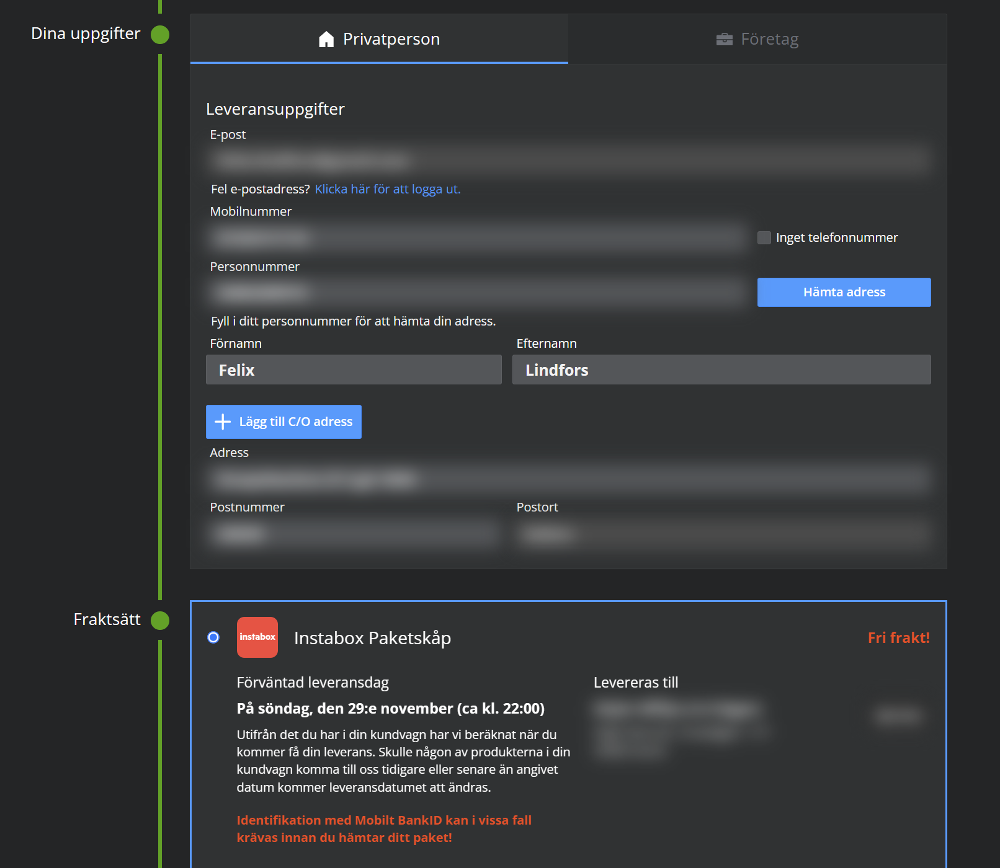
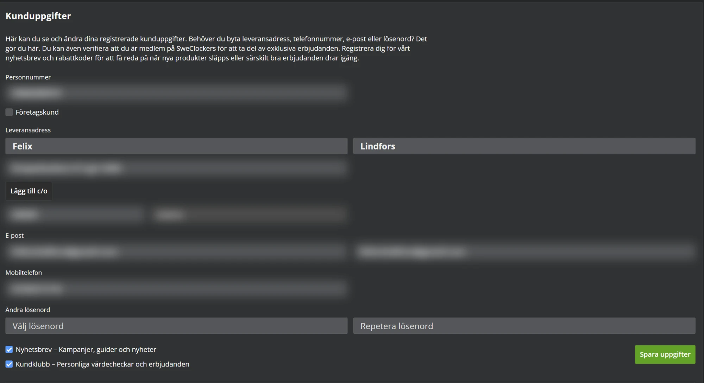

# Inet Streamer Mode

Webbläsartillägg (Firefox + Chrome, Manifest V3) som döljer kunduppgifter i kassan på inet.se när du streamar eller delar skärm.

Döljer: e-post, mobilnummer, personnummer, adress, postnummer, postort, leveransadressen och valt ombud under "Levereras till" (även hos Postnord, DHL, Budbee m.fl.) samt Swish-numret.

## Av/på

Klicka på tilläggets ikon i verktygsfältet och använd reglaget för att slå av eller på streamer mode. Valet sparas och gäller direkt i alla öppna flikar. Standardläget är på.

Reglaget **Opsec mode** byter suddningen mot helsvarta block. Blur går i teorin att återskapa, men det gör inte ett svart block. Opsec mode är av som standard och gäller bara när streamer mode är på.

## Installera

**Chrome:** `chrome://extensions` → slå på *Developer mode* → *Load unpacked* → välj mappen.

**Firefox:** `about:debugging#/runtime/this-firefox` → *Load Temporary Add-on* → välj `manifest.json`.

## Skärmbilder

**Kassan** (leveransuppgifter, mobilnummer, personnummer, adress och "Levereras till" är suddade):

**Kunduppgifter**:

